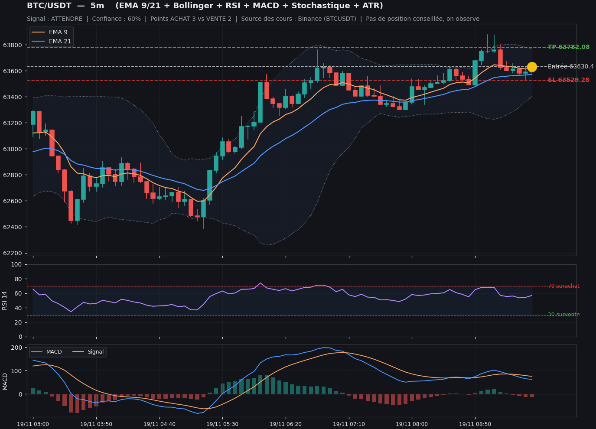

# Bot Telegram de signaux de trading (privé, multi-fichiers)

Bot Telegram qui analyse les graphiques de trading sur 3 familles de marchés
(crypto, forex, OTC/binaires) et t'envoie un signal **ACHAT / VENTE** avec
entrée, Take Profit, Stop Loss, ratio risque/rendement et score de confiance —
**plus une image du graphique** montrant comment il a raisonné (bougies, EMA,
Bollinger, RSI, MACD, niveaux tracés).



---

## 1. Structure du projet (multi-fichiers)

```
telegram-trading-bot/
├── bot.py                  # POINT D'ENTRÉE : commandes, boutons, envoi Telegram
├── config/
│   └── settings.py         # toute la configuration (.env + constantes)
├── data/
│   ├── markets.py          # catalogue des marchés, actifs, sources
│   └── feed.py             # Deriv prioritaire, Binance/Yahoo en secours + cache
├── core/                   # le cerveau : tout le calcul technique
│   ├── indicators.py       # EMA, RSI, MACD, ATR, Bollinger, Stochastique
│   ├── patterns.py         # chandeliers japonais (pin bar, englobante, ...)
│   ├── signal_engine.py    # combine tout -> verdict ACHAT/VENTE/ATTENDRE
│   └── risk.py             # TP/SL, ratio R:R, taille de position
├── services/
│   ├── mtf.py              # contrôle multi-timeframe (5m/15m/1h...)
│   └── scanner.py          # scan automatique de la watchlist
├── outputs/
│   ├── chart.py            # génération de l'image d'analyse
│   └── messages.py         # textes des messages Telegram
├── storage/
│   └── history.py          # historique des signaux + suivi TP/SL + watchlist
├── utils/
│   ├── logger.py           # logs console + logs/bot.log (rotation)
│   └── helpers.py          # heure locale, formats
├── tests/                  # tests unitaires (sans réseau)
│   ├── test_indicators.py
│   ├── test_patterns.py
│   └── test_signal_engine.py
├── deploy/                 # mise en production
│   ├── Dockerfile + docker-compose.yml
│   ├── bot.service         # service systemd
│   ├── run.sh              # lancement en un script
│   └── GUIDE-GITHUB-SERVEUR.md  # GitHub + serveur pour tourner 24h/24
├── data_store/             # (créé au runtime) signaux.json, watchlist.json
├── logs/                   # (créé au runtime) bot.log
├── requirements.txt
├── .env.example            # modèle de configuration
├── .gitignore              # protège .env, logs et données (pour GitHub)
├── README.md
└── exemple_analyse.png
```

Chaque dossier a un rôle clair : tu peux ajouter un indicateur dans `core/`,
un actif dans `data/markets.py` ou une commande dans `bot.py` sans tout casser.

---

## 2. Commandes du bot

| Commande | Effet |
|---|---|
| `/start` | menu de démarrage avec boutons (Crypto / Forex / OTC) |
| `/analyse BTC 5m` | analyse complète immédiate + image |
| `/analyse EUR/USD 15m` | idem forex ; `/analyse XAU 1h` pour l'or |
| `/prix BTC` | prix en direct + variation 24h |
| `/marches` | tous les actifs supportés |
| `/scan on` / `/scan off` | scan automatique de la watchlist |
| `/watch add ETH 15m` | ajouter un actif à la watchlist (persistant) |
| `/watch remove ETH 15m` | retirer ; `/watch clear` tout vider |
| `/stats` | résultats des signaux passés (TP touché vs SL touché) |
| `/id` | ton ID Telegram |
| `/help` | aide détaillée |

À chaque analyse tu reçois **2 choses** :
1. une **image** : bougies, EMA 9/21, bandes de Bollinger, lignes Entrée/TP/SL,
   marqueur du signal, panneaux RSI et MACD ;
2. un **message détaillé** : la trace écrite — chaque module avec ses valeurs,
   les figures de chandeliers détectées, le verdict multi-timeframe, le
   ratio risque/rendement et la suggestion de taille de position.

---

## 3. Installation pas à pas

Prérequis : Python 3.10+ (3.12 conseillé).

### Étape 1 — dépendances
```bash
pip install -r requirements.txt
```

### Étape 2 — token du bot
Sur Telegram : **@BotFather** -> `/newbot` (ou `/token`) -> copie la chaîne
`1234567890:AAE...` (c'est le **token**).

### Étape 3 — ton ID Telegram
Cherche **@userinfobot**, envoie n'importe quoi : il donne ton **Id** numérique.

### Étape 4 — configuration
```bash
cp .env.example .env
```
Puis remplis dans `.env` :
```
BOT_TOKEN=ton_token
ADMIN_ID=ton_id
```
(Toutes les autres lignes ont des valeurs par défaut raisonnables.)

### Étape 5 — lancement
```bash
python bot.py
```
Le bot t'envoie "Bot démarré !". Laisse le terminal ouvert tant que tu veux
que le bot tourne (voir section 7 pour le faire tourner en continu).

### Étape 6 — vérifier les tests (optionnel mais conseillé)
```bash
python tests/test_indicators.py
python tests/test_patterns.py
python tests/test_signal_engine.py
```

---

## 4. Comment le bot décide (système de points)

Chaque module donne des points au scénario haussier ou baissier — maximum 12
par côté :

| Module | Points max | Ce qu'il regarde |
|---|---|---|
| Tendance EMA 9/21 | 2 | prix au-dessus/en-dessous + EMA9 vs EMA21 |
| Croisement EMA récent | 2 | retournement sur les dernières bougies |
| RSI(14) | 2 | survente < 30 (achat), surachat > 70 (vente), biais 45/55 |
| MACD(12,26,9) | 2 | ligne vs signal + direction de l'histogramme |
| Bandes de Bollinger(20,2) | 1 | prix collé à une bande extrême |
| Stochastique(14,3) | 1 | croisements en zones basses (< 25) / hautes (> 75) |
| Chandeliers japonais | 2 | pin bar, englobante, marubozu, 3 soldats/corbeaux |

Décision :
- **Direction** = côté dominant ; **Confiance %** = sa part du total
- Signal confirmé seulement si : confiance >= 62% **et** écart >= 2 points
  **et** côté dominant >= 5 points (réglables dans `.env`)
- **TP / SL** calibrés sur l'ATR : TP = entrée + 1,5 x ATR,
  SL = entrée - 1,0 x ATR -> ratio risque/rendement 1:1.5 par défaut
- **Multi-timeframe** : le bot revérifie sur les timeframes supérieurs
  (ex : 5m -> 15m + 1h) et te dit si le signal est renforcé ou fragile
- **Suivi automatique** : chaque signal confirmé est enregistré ; à chaque
  scan et /stats, le bot vérifie sur les cours réels si le TP ou le SL a été
  touché en premier et calcule ton taux de réussite par actif
  (les deux touchés dans la même bougie = compté perdu, hypothèse conservatrice)

---

## 5. Marchés et sources (le point sur le "courtier")

Tu avais raison : deux plateformes qui affichent le **même actif** montrent le
**même graphique**, car le cours vient du même marché. Le bot ne se connecte
pas à ton broker :

| Famille | Ordre des sources | Actifs |
|---|---|---|
| Toutes les familles | **Deriv** si l'instrument exact est listé, puis source de secours | Forex, crypto et instruments Deriv disponibles |
| Crypto | **Deriv → Binance → Yahoo Finance** | BTC, ETH, BNB, SOL, XRP, ADA, DOGE (USDT) |
| Forex, actions, ETF, indices, matières premières | **Deriv → Yahoo Finance** | Actifs du catalogue, uniquement si le symbole Deriv correspond exactement |
| OTC / binaires | Données de l'actif réel correspondant ; Deriv en priorité s'il est listé | EUR/USD OTC, GBP/USD OTC, USD/JPY OTC, XAU/USD OTC, BTC/USD OTC, ETH/USD OTC |

- Les données de marché publiques Deriv ne nécessitent pas de jeton personnel.
- Binance et Yahoo Finance sont utilisés automatiquement si Deriv ne propose pas
  l'actif ou si son flux est indisponible.
- Le forex ferme le week-end : "aucune donnée" samedi/dimanche est normal.
- Ton broker peut afficher un écart minuscule (spread) : vérifie l'entrée sur
  ta plateforme avant de trader.

Les analyses manuelles `/analyse` attendent 20 secondes puis recalculent le
signal sur des cours actualisés. Si la direction change entre les deux passes,
le bot répond `ATTENDRE`. Ce délai est réglable via
`ANALYSIS_CONFIRMATION_SECONDS` (0 pour le désactiver) ; il ne garantit pas
qu'un signal soit rentable.

---

## 6. Réglages (fichier `.env`)

| Variable | Défaut | Rôle |
|---|---|---|
| `BOT_TOKEN` / `ADMIN_ID` | (obligatoires) | token du bot / ton ID |
| `ALLOWED_IDS` | vide | autres IDs autorisés |
| `SIGNAL_MIN_CONFIDENCE` | 62 | confiance minimale pour un signal |
| `SIGNAL_MIN_POINTS` | 5 | points minimum (sur 12) |
| `SIGNAL_MIN_MARGIN` | 2 | écart minimum entre les deux côtés |
| `SCAN_INTERVAL_MIN` | 5 | intervalle du scan automatique |
| `COOLDOWN_MIN` | 15 | délai avant de renvoyer le même signal |
| `AUTO_SCAN` | 0 | démarre le scan automatiquement au lancement (`1` pour l'activer) |
| `WATCHLIST` | BTC 5m, EUR/USD 5m, BTC OTC 5m | watchlist initiale |
| `BALANCE` / `RISK_PCT` | 0 / 1.0 | balance fictive et % de risque -> taille de position |
| `TP_ATR` / `SL_ATR` | 1.5 / 1.0 | calibration TP/SL sur l'ATR |
| `TZ_NAME` | Africa/Lubumbashi | fuseau affiché |
| `NB_CANDLES_CHART` | 80 | bougies dessinées sur l'image |
| `FEED_CACHE_TTL` | 25 | cache des cours (secondes) |
| `DERIV_APP_ID` | 1089 | ID d'application public utilisé par le WebSocket Deriv |
| `ANALYSIS_CONFIRMATION_SECONDS` | 20 | délai avant confirmation d'une analyse manuelle |

Pour ajouter des actifs : `data/markets.py` (`CRYPTO_ASSETS`, `FOREX_ASSETS`,
`OTC_ASSETS`, `OTC_ROUTE`).

---

## 7. Faire tourner le bot en continu

Options d'exécution :

**a) Sessions GitHub Actions** (mode expérimental, disponibilité non garantie) :

Le workflow `.github/workflows/bot-24h.yml` démarre le bot en sessions
programmées et sauvegarde l'historique. Ajoute les secrets `BOT_TOKEN` et
`ADMIN_ID` dans **Settings > Secrets and variables > Actions**, puis teste-le
depuis **Actions > Bot par sessions > Run workflow**.

Ce n'est pas un hébergement 24h/24 garanti : chaque session s'arrête après
environ 5 h 35, et le bot ne répond pas pendant les interruptions. GitHub peut
aussi retarder un lancement. La cron `3 */6 * * *` est en UTC (02:03, 08:03,
14:03 et 20:03 en UTC+2). Utilise ce mode seulement pour un dépôt public et
vérifie les limites et règles d'utilisation GitHub Actions. Pour une présence
interactive fiable en continu, utilise plutôt un VPS ou un serveur toujours actif.
Voir le [guide GitHub Actions](./deploy/GUIDE-GITHUB-ACTIONS.md) pour la mise en place.

**b) Script local** (Linux/macOS) :
```bash
deploy/run.sh          # crée le venv, installe, lance
```

**c) Docker** :
```bash
cd deploy && docker compose up -d --build
docker compose logs -f bot
```

**d) systemd** (serveur Linux) :
```bash
sudo cp deploy/bot.service /etc/systemd/system/   # adapter User et chemin
sudo systemctl enable --now trading-bot
journalctl -u trading-bot -f
```

Les données (`data_store/`) et les logs (`logs/`) survivent aux redémarrages.
Pour l'hébergement 24h/24 via GitHub (créer le dépôt, le pousser, déployer sur
un serveur gratuit ou un VPS), suis le pas-à-pas complet :
**`deploy/GUIDE-GITHUB-SERVEUR.md`**.

---

## 8. Dépannage

| Symptôme | Solution |
|---|---|
| `BOT_TOKEN manquant` | crée le `.env` (copie `.env.example`) |
| `ADMIN_ID manquant` | récupère ton ID via @userinfobot puis remplis le `.env` |
| "Ce bot est privé" | ton ID n'est pas dans `ADMIN_ID`/`ALLOWED_IDS` |
| "Impossible d'analyser... marché fermé" | forex fermé le week-end ou API indisponible : réessaie plus tard |
| Binance HTTP 418 | ban temporaire de Binance (trop de requêtes) : le bot bascule sur Yahoo, attends quelques minutes |
| Le bot ne répond plus | terminal fermé ou coupure réseau : relance (ou systemd/docker qui relance tout seul) |

---

## 9. Avertissement important

Ce bot est un **outil éducatif d'analyse technique**. Les signaux sont le
résultat de calculs sur les cours passés : **aucun signal n'est garanti**, le
marché peut se retourner instantanément, et le trading (marge, options
binaires) comporte un **risque de perte totale**. Ne trade jamais de l'argent
dont tu as besoin, et ne considère pas ce bot comme un conseil financier.
Vérifie toujours les niveaux sur ta plateforme avant d'agir.
